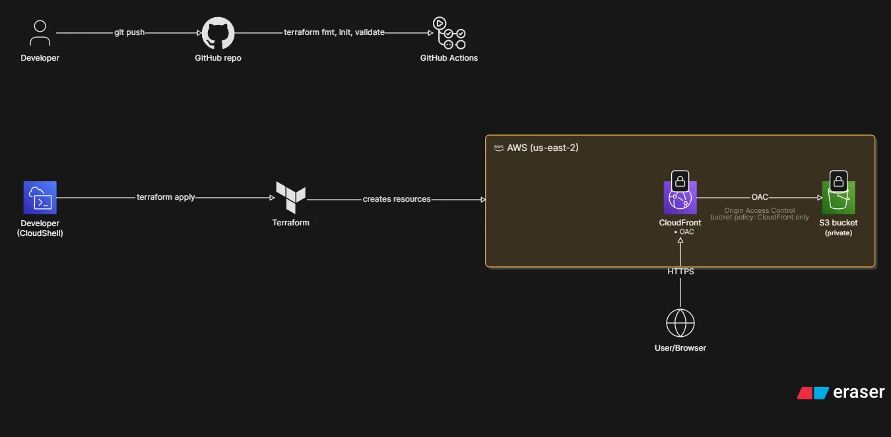
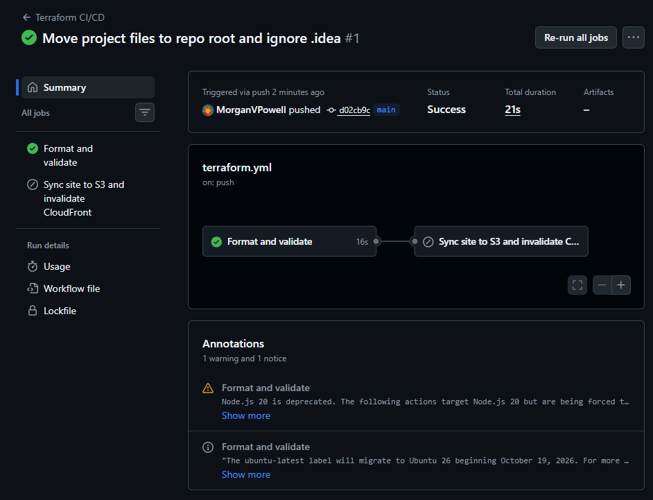
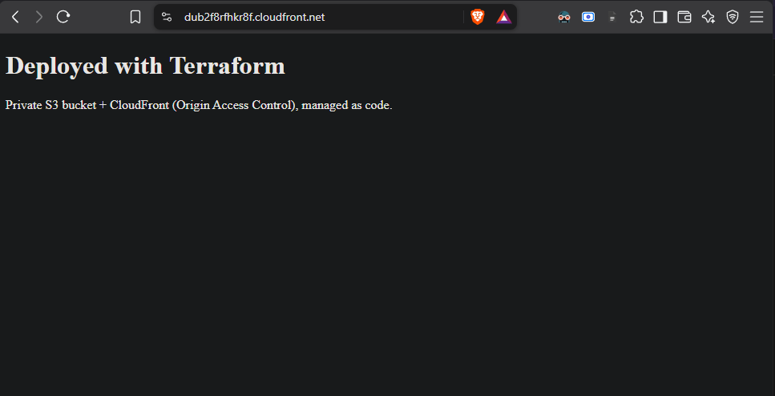

# Terraform Static Website (S3 + CloudFront)

Infrastructure as Code version of my static website project. A private S3 bucket is served over HTTPS through CloudFront with Origin Access Control (OAC), defined in Terraform and validated by a GitHub Actions pipeline.

## Architecture



## What it creates

- Private S3 bucket with all public access blocked
- CloudFront distribution with HTTPS redirect and `index.html` as the default root object
- Origin Access Control and a bucket policy that lets only this CloudFront distribution read the bucket
- `index.html` uploaded as an S3 object
- Random suffix so the bucket name is globally unique

## Usage

Run from AWS CloudShell:

```
terraform init
terraform plan
terraform apply
terraform destroy   # clean up when finished
```

The AWS region defaults to `us-east-2` and can be changed with `-var="region=..."`.

## CI/CD

GitHub Actions runs `terraform fmt -check`, `terraform init -backend=false`, and `terraform validate` on every pull request and push to `main`. An optional job syncs the site to S3 and invalidates the CloudFront cache once an AWS role is configured; it is skipped until then.



## Result



## Issues hit and fixes

- **S3 CreateBucket denied (403, service control policy):** my Terraform defaulted to `us-east-1`, but the account only allows `us-east-2`. Fixed by changing the region default and rerunning `apply`.
- **Plan showed the bucket as deleted:** after a region mismatch, Terraform looked in the wrong region and planned to recreate the bucket. Setting the correct default made `plan` report no changes.
- **GitHub Actions found no workflows:** the project was committed inside a subfolder, so `.github/workflows` was not at the repo root. Moved the files to the root and the pipeline ran.
- **Git push rejected:** GitHub no longer accepts account passwords, so I used a personal access token with `repo` and `workflow` scopes.

## Cleanup

All resources are removed with `terraform destroy`.